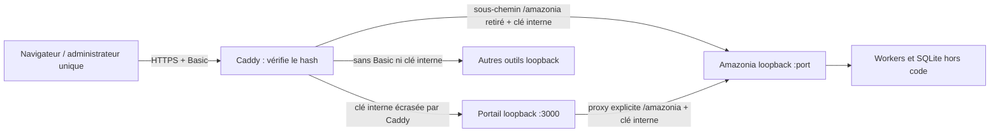

# 1B.5 — entrée personnelle commune, préparation uniquement

Base portail : `456199e66814958edc40d5580a0f73744fecc2ac`. Amazonia doit inclure PR #5 fusionnée (base `cb80c06`) et la PR associée 1B.5. Aucun déploiement, changement Oracle ou données réelles pendant cette mission. Les deux PR attendent revue ChatGPT et validation du propriétaire. La fusion et le déploiement sont deux décisions distinctes.

## Responsabilités et flux

Un seul identifiant Basic Auth, vérifié uniquement dans Caddy ; aucun compte, session, JWT ou fournisseur externe ajouté. Caddy place basic_auth avant toutes les branches, y compris redirections, racine, outils et API. Il remplace X-Atelier-Internal pour le portail et Amazonia après succès de Basic ; il supprime ce header pour les autres outils. Authorization Basic n'est jamais transmis aux backends. Les faux headers d'identité sont retirés. Les cookies ne sont pas utilisés par Amazonia/portail et sont retirés de leurs branches ; ceux des autres outils sont préservés pour compatibilité.

Le portail et Amazonia vérifient la clé interne lue dans leur fichier privé, comparaison constante après format/longueur. Absente : 503 ; incorrecte : 403. Aucun `authorize: () => true` en production. Une requête directe portant seulement Basic ou x-user échoue. Le proxy interne du portail vérifie d'abord l'entrée, ne route plus selon Referer ni par repli arbitraire sur un outil, et ne transmet la preuve qu'à Amazonia. L'accès direct aux ports doit également être limité par loopback/pare-feu.

Basic Auth est ambiant dans le navigateur : toute mutation exige une Origin HTTPS exacte de la liste configurée et application/json ; Fetch Metadata cross-site est aussi refusé. Un formulaire externe ou un appel sans Origin ne peut pas muter, même si le navigateur réutilise Basic. Origin seul n'est jamais une autorisation : la preuve interne est vérifiée avant. Les scripts opérateur doivent fournir Origin et JSON en plus de leurs identifiants Basic. Pas de CORS permissif.

## Changements minimaux et restrictions volontaires

- Portail sur loopback uniquement, garde commune avant parsing/routes/fichiers, corps 256 Kio ; Node >=24 déclaré et démarrage production explicite.
- Liste fermée d'actions start/stop/restart/clear-logs/delete/diagnose ; aucun nom d'action arbitraire dans systemctl.
- Identifiants, dépôts owner/repo, branches, noms, ports, unités et chemins de déploiement contraints ; collisions refusées pour nouveaux outils et génération Caddy. Les champs execStart/buildCmd HTTP sont ignorés : la détection de pile fournit la recette ; preset custom refusé. Un registre existant reste une configuration d'administration locale à auditer, pas une entrée HTTP de confiance.
- Les archives ZIP HTTP sont refusées 409, y compris à la création. Staging manuel requis : limites d'extraction, vérification des liens/chemins, données hors code. Cette livraison ne prétend pas rendre unzip/rsync sûrs face aux archives non fiables ; elle retire ce chemin. UI correspondante désactivée.
- Le déploiement Git reste disponible pour des dépôts explicitement choisis et de confiance. Npm peut exécuter leurs scripts : déployer un dépôt signifie autoriser son code, pas seulement ses fichiers. Cette mission ne construit pas un bac à sable pour code tiers.
- Amazonia est identifié par repo ou ID : recette backend dédiée, contrôle réel du binaire Node >=24 + node:sqlite, aucun patch regex de source/worker, aucun repli Python statique, aucun fuser -k. L'unité pointe le Node absolu choisi, User=amazonia et /etc/amazonia/service.env. Répertoire de données externe préexistant requis avant mise à jour Git ; même valeur dans le fichier d'environnement Amazonia à vérifier par l'opérateur.
- Démarrer le portail ne lance plus d'auto-réparation/déploiement ni de remplacement Caddy. GET overview ne génère plus de clé SSH. La suggestion sudo général a été retirée ; les commandes privilégiées existantes nécessitent encore une politique locale limitée, validée humainement.
- Une modification des outils prépare un Caddyfile protégé en /tmp dans un répertoire privé, et signale l'activation manuelle requise. Elle ne remplace plus /etc/caddy/Caddyfile. Cela évite de valider avec un environnement sudo ne contenant pas les variables du service Caddy, et de remplacer aveuglément sa configuration. La CLI `node --import tsx scripts/prepare-caddy.ts REGISTRE_ABSOLU SORTIE_NOUVELLE` prépare également un fichier sans écrasement.
- L'API d'administration Caddy est désactivée dans le fichier généré : elle exposerait localement la configuration développée et la clé. La mise à jour exige donc un redémarrage contrôlé du service, après validation. Évaluer l'impact sur les connexions des autres outils ; les campagnes Amazonia vivent hors connexions HTTP.

## Configuration manuelle Oracle, jamais créée par cette PR

1. Inventorier les unités/processus, version active Git, registre, ports, Caddy complet, binaire Node réel, compte de chaque application, chemins data/JSON/quarantaine/SQLite/WAL/SHM et protections réseau. Les DEFAULT_TOOLS ne prouvent rien sur Oracle. Vérifier les noms et chemins du registre contre les contraintes ; toute entrée incompatible arrête le démarrage au lieu d'être réécrite silencieusement.
2. Préparer un unique utilisateur Basic et un mot de passe fort par saisie opérateur ; générer son hash avec `caddy hash-password` interactif. Aucun mot de passe ni hash réel dans GitHub ou dans un rapport. Préparer une clé interne aléatoire de 32 octets minimum, encodée hexadécimale (`openssl rand -hex 32` exécuté uniquement par le propriétaire dans un contexte privé).
3. Créer trois configurations privées distinctes, hors checkout. Caddy doit recevoir par EnvironmentFile root-owned 0600 : ATELIER_BASIC_USER, ATELIER_BASIC_HASH et ATELIER_INTERNAL_KEY (valeur de la clé). Portail et Amazonia reçoivent chacun ATELIER_INTERNAL_KEY_FILE pointant leur copie privée de cette même clé, fichier régulier canonique absolu 0400/0600 accessible uniquement au service. Pas de clé dans le navigateur, une URL, logs ou commande de test publiée. Protéger les dossiers parents et les sauvegardes des fichiers de configuration.
4. Les deux services reçoivent ATELIER_PUBLIC_ORIGINS=https://atelierconceptionjeu.fr,https://www.atelierconceptionjeu.fr (liste exacte, sans slash final). Inclure seulement les noms réellement utilisés et couverts par HTTPS. La même clé doit être chargée par les trois processus ; rotation coordonnée avec redémarrage, aucun repli permissif.
5. Portail : compte dédié et droits sudo strictement nécessaires aux unités prévues, pas `NOPASSWD: ALL`. Prévoir AMAZONIA_NODE_BINARY (chemin réel canonique d'un Node 24, référence de recette 24.22.1) et AMAZONIA_CAMPAIGNS_DIR (par exemple /var/lib/amazonia/campaigns, réellement existant et hors /srv/jeu ou /home/opc). N'installer aucun Node automatiquement depuis le portail.
6. Amazonia : compte `amazonia`, droits lecture sur la release et écriture sur le seul stockage ; /etc/amazonia/service.env privé contient NODE_ENV=production, AMAZONIA_CAMPAIGNS_DIR, ATELIER_INTERNAL_KEY_FILE et ATELIER_PUBLIC_ORIGINS. Le fichier d'unité fixe PORT depuis le registre. Vérifier sous le compte réel les permissions et l'import node:sqlite. Préparer le marqueur de stockage uniquement après inventaire si la première initialisation est intentionnelle.
7. Backends : vérifier écoute loopback de chaque outil et absence de règles OCI/pare-feu publiant leurs ports. Ne publier que HTTPS/HTTP de redirection Caddy. Examiner interfaces IPv6 et autres processus ; loopback ne prouve pas à lui seul une autorisation.

## Ordre de déploiement coordonné et critères de recette

Après revue des deux PR et autorisation distincte d'infrastructure : sauvegarder code/configuration/données puis tester leur restauration isolée ; préparer les fichiers privés et comptes ; installer la release Amazonia incluant son adaptateur en mode fermé ; préparer le portail protégé sur loopback (l'ancienne entrée ne lui fournit pas de preuve, donc elle sera refusée pendant la transition) ; générer Caddy depuis le registre réel, vérifier tous les outils et les protections spécifiques existantes. **Ne jamais écraser des routes/manipulations Caddy locales sans les réconcilier**.

Dans un contexte opérateur protégé chargé avec l'EnvironmentFile du service, exécuter `caddy validate --config FICHIER_PREPARE --adapter caddyfile` avec exactement le binaire/environnement de Caddy. Les valeurs manquantes doivent faire échouer la validation. Sauvegarder la configuration active puis installer manuellement la version revue et redémarrer Caddy. Pas de rechargement via API admin désactivée, ni période d'exposition sans auth. Tester d'abord avec faux secrets en recette, puis les identifiants réels uniquement dans le client de l'opérateur.

Vérifications indispensables : sans Basic et Basic incorrect => 401 partout, y compris outils, API, www, sous-chemins sans slash et routes administratives ; Basic correct => page portail, toutes les API requises et lecture des anciennes campagnes ; faux headers/preuve absente et accès direct => refus ; Origin malveillante/mutation non JSON => refus. Aucun secret en réponse ou logs. Une réponse index.html en 200 ne constitue pas une santé backend. Tester une petite campagne avec autorisation dédiée, fermer complètement le navigateur puis consulter depuis un second appareil ; vérifier progression/checkpoints sans doublon, reprise explicite après interruption, CPU/RAM/disque. Les autres outils doivent conserver leurs fonctions ; Basic seul ne corrige pas leurs propres vulnérabilités.

## Sauvegarde, données et retour arrière

Réutiliser les outils 1B.4 documentés dans Amazonia : sauvegarde SQLite active cohérente incluant WAL via API backup, integrity_check, manifeste et empreintes, conservation JSON/quarantaine, destination nouvelle et copie hors VM. La restauration exige absence d'écrivain et répertoire propre ; jamais réutiliser un WAL/SHM ancien ni supprimer le bail actif. Pour un ancien stockage JSON sans SQLite, copie complète à l'arrêt, sans créer une base simplement pour sauvegarder. Aucun outil de sauvegarde de production exécuté ici.

Les données doivent être hors checkout **avant** reset --hard ou clone. Un répertoire non vide sans .git est désormais refusé par le mécanisme de clonage ; les chemins symboliques sont refusés. Ne jamais y placer des données uniques, ni compter sur reset --hard pour les préserver. Préserver l'original pendant la migration et vérifier empreintes. Aucun redémarrage ne crée de campagne automatique.

Conserver versions exactes, dépendances et configurations privées dans un stockage protégé. Un rollback applicatif doit rester compatible avec le schéma et la provenance scientifique. 1B.5 ne modifie ni campaignManager ni la science : elle ne change pas leur empreinte par rapport à 1B.4. Les checkpoints SCIENTIFIC_V1 antérieurs à 1B.4 peuvent toujours refuser reprise ; ne pas modifier leur manifeste, utiliser une copie et l'ancienne release exacte, ou accepter une nouvelle campagne après décision humaine. Ne pas revenir au serveur JSON ancien contre la base durable.

En cas d'échec d'authentification, garder le service fermé ; ne jamais remettre en ligne l'ancien portail sans filtre. Restaurer une release compatible conservant l'entrée Basic et les gardes, ou couper l'accès externe. Toute restauration des données se fait dans un nouveau répertoire après sauvegarde de l'état courant ; les campagnes postérieures à la sauvegarde ne seront pas dans l'ancien état et doivent rester archivées séparément. Aucune fusion de bases ni suppression automatique.

## Limites assumées

Un seul administrateur, pas de rôles distincts ni audit nominatif. Basic Auth n'offre pas un logout fiable universel : fermer la session du navigateur ou changer le mot de passe côté serveur ; aucun effet sur les campagnes. Tous les outils de même origine doivent être de confiance : une XSS dans un outil peut agir avec les droits Basic de l'utilisateur sur les autres. La clé partagée est un credential d'administration entre services : sa fuite ou la compromission d'un service qui la possède compromet la frontière commune. Les comptes isolés et fichiers privés réduisent ce risque sans l'annuler ; les dépôts déployés restent de confiance.

L'anti-bruteforce réseau, le durcissement complet des autres outils et l'isolation de code tiers ne sont pas livrés. Caddy doit être exposé uniquement en HTTPS (HTTP local utilisé dans les tests) ; reverse proxy, firewall, clés, permissions et droits effectifs restent à constater sur Oracle. La vérification locale n'est pas une attestation de production.

## Validation locale

- Tests unitaires du portail et test croisé avec un vrai Caddy 2.10.2 téléchargé pour la recette seulement. Caddy lancé sur HTTP loopback éphémère, admin off, mot de passe fictif et clé aléatoire temporaire, aucune production contactée.
- Commande croisée : `CADDY_TEST_BINARY=/chemin/caddy AMAZONIA_TEST_ROOT=/chemin/checkout-Amazonia-1B5 npm test`. Sans ces variables, le test croisé est explicitement ignoré ; cinq tests indépendants restent exécutables.
- Le test croisé vérifie Basic correct/incorrect/absent, remplacement des faux headers, garde directe des deux backends, sous-chemin Caddy, proxy du portail, CSRF, création et lecture d'une campagne de dix parties après déconnexion HTTP. Aucun polling pendant le calcul.
- `npm run lint`, `npm run build`, `git diff --check`. Les tests de sauvegarde/reprise, science et v3.3 sont exécutés dans la PR Amazonia associée. Les tests locaux n'ont modifié ni registre réel ni données Oracle.

Résultats finaux : sept tests portail réussis, dont un Caddy HTTP local, un Caddy HTTPS local avec Chromium entièrement fermé pendant une campagne de 40 parties puis second navigateur, et les contrôles de préservation d'un répertoire sans Git. Pour inclure Chromium : ajouter `PLAYWRIGHT_TEST_MODULE=/chemin/playwright/index.mjs CHROMIUM_TEST_BINARY=/chemin/chromium` à la commande croisée. Le certificat local est ignoré uniquement dans cette recette isolée ; le Caddy de recette n'installe aucune autorité dans le système (skip_install_trust, stockage temporaire). Typage/build/diff-check réussis ; avertissement Vite préexistant relatif à __dirname dans sa configuration. Amazonia : 90 tests réussis, typage et build réussis, empreintes scientifiques non modifiées. Aucun résultat de production revendiqué.
